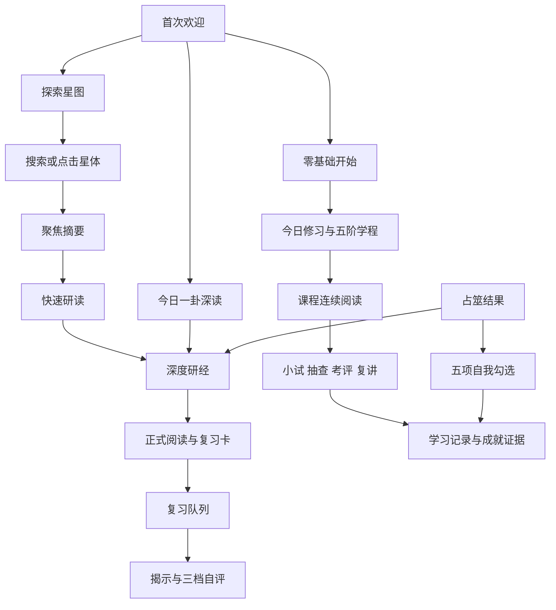
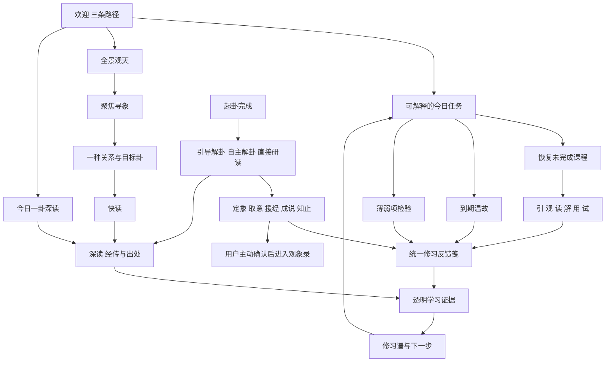

# 01｜产品定位、信息架构与完整用户旅程

更新日期：2026-10-24（Asia/Shanghai）。

[返回开发建设总册](../DEVELOPMENT-MASTER.md) · [星图与阅读](03-star-map-search-reading.md) · [学习与考评](04-learning-library-assessment.md) · [验收证据](10-testing-evidence.md)

## 1. 本附件怎么使用

本附件定义“产品要让谁完成什么”，同时区分当前代码、已经确认的目标和未来能力。
它不是当前网站已经全部实现的功能宣传，也不是新的云平台建设立项。
下一位 AI 先看本文件的旅程，再阅读对应专题和任务卡，最后进入代码。
不得直接从旧截图或旧 PRD 推导新入口、评分和数据写入规则。

### 1.1 三轴状态

所有需求同时记录三个维度，不能用单独一个“完成”代替。

| 轴 | 可用值 | 含义 |
| --- | --- | --- |
| 需求 | 已确认 / 建议 / 未来独立方案 | 已确认来自用户、现行基线或对应业务 PRD；建议尚未构成业务承诺 |
| 实现 | 已实现 / 部分实现 / 未实现 / 受门禁阻塞 | 表达当前代码能力，而非仅说明有文档或按钮 |
| 验证 | 本轮通过 / 历史通过 / 本轮失败 / 未验证 | 每次必须附命令、时间、环境和证据；静态检查不等于真人体验 |

本轮是 2026-10-24 的文档梳理。
本轮 `npm run check` 和 `npm run validate` 通过，validate 为 230 项、0 失败。
本轮默认 `npm run test:e2e` 已有失败，不能用 2026-10-22 的通过记录覆盖；逐次结果以证据摘要为唯一记录。
只读阶段分别观察到画布选星和快读“六爻”响应失败，文档实施复跑再次复现后者。
原因尚未确定，先执行总册中的 P0 验收诊断任务。
验证范围和原始证据入口以 [测试与证据](10-testing-evidence.md) 为准。

### 1.2 事实优先级

1. 用户最近明确确认的要求。
2. `docs/UI-DESIGN-BASELINE.md` 的已确认界面交互决策，以及各业务 PRD 的算法、内容和数据约定。
3. 总册对当前事实、范围、兼容、差距和任务状态的整理；不得覆盖上位确认规则。
4. 当前代码、测试及实际运行证据。
5. 带日期的交接记录、历史计划和截图。

如果“目标行为”和当前代码不一致，应标为差距并建立任务。
不得为了让文档看起来统一，把目标改成代码当前恰好做到的程度。
不得把历史已修复缺陷重新安排为从零开发。

## 2. 产品是什么

易象图谱是以六十四卦关系星图为入口的《易经》文化学习工具。
核心价值是把浏览、经文、关系推演、主动回忆、间隔复习和学习证据连起来。
用户应该逐渐从“知道卦名”走向“能说出结构、引用依据并承认解释边界”。
星图负责激发兴趣、显示结构和引导观察。
稳定正文负责阅读和理解。
小试、复习、复讲与实践负责暴露薄弱点。
修习谱负责解释已有证据和下一步，而不是制造积分竞争。

### 2.1 当前建设边界

| 能力 | 范围结论 | 三轴状态 |
| --- | --- | --- |
| 原生静态网站 | `web/`，HTTP 加载 JSON，原生 DOM、Canvas、本地 Three.js | 已确认 / 已实现 / 本轮静态与逻辑检查通过，e2e 有失败 |
| Windows 本地版本 | 把同一站点和本地服务封装为单文件发行物 | 已确认 / 已有实现 / 旧版本历史通过，本轮未重建 |
| 浏览器本地学习数据 | localStorage 保存；用户主动备份、导入和清理 | 已确认 / 已实现 / 核心逻辑本轮通过 |
| 可选智能复讲 | 只允许安全同源代理地址；未配置或异常时使用本地自评 | 已确认 / 前端契约已实现 / 逻辑本轮通过，实际代理未验证 |
| 自建业务后端 | 当前仓库没有账号、数据库和同步服务 | 未来独立方案 / 未实现 / 未验证 |
| 云账号、跨设备同步 | 需独立需求、隐私、冲突合并和运维方案 | 未来独立方案 / 未实现 / 未验证 |
| 内容管理后台 | 不在本轮静态项目完善范围内 | 未来独立方案 / 未实现 / 未验证 |
| 公开社交、排行榜、商城 | 现行产品不采用 | 已确认非目标 / 不实施 / 不适用 |
| 现实预测和专业决策 | 不评价占得准不准，不提供专业建议 | 已确认禁止边界 / 文案和部分流程已落实 / 内容仍需持续审核 |

本地 `npm start` 启动的是文件服务，不代表存在业务 API。
静态站点不能因为配置了 `/api/learning-review` 就自动具备模型服务。
浏览器不保存模型密钥，不把私人笔记或占筮问题默认上传。
详细边界见 [架构与服务](02-architecture-services.md) 和 [安全与离线](09-security-performance-offline.md)。

### 2.2 目标用户

| 用户 | 进入时的问题 | 产品应给出的帮助 | 不能承诺 |
| --- | --- | --- | --- |
| 零基础学习者 | 不知道从哪里开始，阴阳、八卦、六十四卦容易混淆 | 一条可继续的课程路径、可回查的基础概念和小试 | 看完一课就已掌握 |
| 经文阅读者 | 查得到字，不理解结构和解释层次 | 卦体、上下卦、经传、出处和项目解释分层 | 每卦只有一个正确现代解释 |
| 关系探索者 | 不理解错、综、互、变的计算 | 一次一种关系、明确变化规则、可对照目标卦 | 星图位置代表真实天体坐标 |
| 复习者 | 反复看书但不能主动回忆 | 先提取再揭示、自评透明、安排下一次温故 | 一次答对就永久记住 |
| 术数文化学习者 | 想理解传统方法和日用术语 | 方法来源、结构演示、证据与边界 | 医疗、法律、财务、婚姻等现实建议 |
| 接手开发的 AI | 不了解过去的决定和未完成点 | 可核验现状、需求 ID、依赖与验收卡 | 仅凭旧文档就能安全改动全部模块 |

### 2.3 产品成功定义

成功要以可完成的行为和可解释的学习记录描述。

- 首次访问能看懂三条开始路径，各入口能到达相应场景。
- 星图能完成“全景→聚焦→关系→快读→深读→逐层返回”，且不丢镜头和草稿。
- 用户能区分原典、易传、历代注疏、项目导读和现代类比。
- 用户能从课程继续到小试、复习、复讲和相关经文，不被成绩锁课。
- 用户能了解“为什么推荐这一项”以及“本次操作写入了什么学习证据”。
- 用户能主动导出和恢复数据；坏备份或存储失败不悄悄覆盖已有学习记录。
- 用户能够只用键盘完成核心流程；手机核心路径可以完成。
- 内容未校验时显示状态，注疏门禁不因 UI 完成而放开。
- 真实设备、读屏和真实 200% 缩放未取得证据时，交付报告继续明确列出。

不把停留时长、连续签到或成就数量作为唯一成功标准。
不新增没有用户授权的行为追踪或第三方分析。
需要量化产品效果时，先设计可解释、最小化和可关闭的方案。

## 3. 全站信息架构

### 3.1 三条欢迎路径

| 入口 | 当前目的地 | 已确认目标 | 写入边界 | 返回 |
| --- | --- | --- | --- | --- |
| 零基础开始 | 学习模块今日修习，尚不直接打开第一课 | 直接进入学程起点l1-1；继续研习由今日修习承担，T-LEARN-01落实 | 不因打开欢迎按钮直接增加掌握度 | 使用模块导航或返回课程 |
| 探索星图 | 全景观天；尚未选择卦 | 保持当前行为 | 只浏览不计正式深读 | 可进入任何主模块 |
| 今日一卦 | 当前项目日选卦的明确深读 | 保持明确阅读场景 | 按已有深读幂等规则记录 | 关闭后留站内，返回聚焦/星图 |

当前欢迎层是模态入口，打开时背景 inert，关闭后释放。
本会话是否已看过欢迎层和是否已播放星图入场是不同状态。
分享深链可以跳过欢迎层直接进入明确阅读，不得先覆盖成随机卦。
三路径的文案、焦点顺序和图标应保持清楚，不引入第四个同权重营销入口。

### 3.2 六个主导航

顺序固定：**黄历、探索、学习、复习、测验、占筮**。

| 模块 | 首要任务 | 容器 | 相关次级能力 |
| --- | --- | --- | --- |
| 黄历 | 理解所选日期的时序和民俗资料 | 宽幅工作台 | 日期、节气、术语笺注、学习与历笺分享 |
| 探索 | 观察六十四卦关系和图式 | 全景、聚焦、快读、深读 | 搜索、五种图式、关系、演变、卦序转盘 |
| 学习 | 知道今天继续什么并系统研读 | 专注修习工作台 | 今日修习、五阶学程、典籍书库、修习谱 |
| 复习 | 主动回忆并安排下次温故 | 稳定内容工作台 | 到期队列、翻面、自评、回原文 |
| 测验 | 验证知识并定位薄弱点 | 稳定题目工作台 | 随机题、错题回练、依据与下一题 |
| 占筮 | 学习传统起卦方法并回到经文 | 宽幅步骤工作台 | 金钱、简化梅花、历史记录、解卦学习挑战 |

卦序转盘不增加为第七主导航。
演变实验室属于探索，独立入口受六家注疏内容门禁控制。
资料与数据设置不新增为学习一级标签，而由书库或修习谱下级进入。
导航激活态必须与真正展示的工作区一致，异步模块加载失败时也要可恢复。

### 3.3 学习的四个一级入口

| 入口 | 用户问题 | 当前实现 | 尚需补全 |
| --- | --- | --- | --- |
| 今日修习 | 我在哪里、今天做什么、为什么 | 有继续研习、温故、即时小试、节律 | 完整推荐优先序、任务恢复和推荐原因 |
| 五阶学程 | 全部内容怎么组织 | 五阶课程全部开放，有课内六步 | 具体课程内容和来源仍持续校勘 |
| 典籍书库 | 要按什么资料线索查 | 八卦、十翼、象数、黄历入口 | 长文阅读细节与出处提示逐项验收 |
| 修习谱 | 我已积累什么证据 | 能力、已解锁印记、考评/设置入口 | 全量印谱进度、证据详情、观象录 |

`assessment`、`data` 等旧 section ID 仍可通过内部映射进入修习谱。
兼容旧入口不等于继续把这些内容放回一级导航。

## 4. 三种“学阶”概念不能混用

当前代码同时存在课程级别、掌握度称谓和成就成长称谓。
这是接手时容易混淆的数据与文案问题，修改前先确认正在显示哪一种。

| 概念 | 来源 | 当前取值 | 作用 |
| --- | --- | --- | --- |
| 课程五阶 | `learning-curriculum.js` | 蒙学、习经、研传、明辨、通用 | 内容组织；不是权限或解锁条件 |
| 学习掌握度称谓 | `learning-progress.js:getLearningRank` | 初闻、蒙学、习读、明辨、通达 | 按课程综合掌握度阈值显示 |
| 修习谱成长阶段 | `achievement-catalog.js:GROWTH_RANKS` | 五阶×初识/渐悟/成章，共 15 状态 | 按成就、能力、实践和研读等条件表达成长 |

当前今日修习调用课程掌握度 summary 的 rank。
当前修习谱调用成就 summary 的 rank。
课程五阶本身不能被掌握度称谓替换。
开发时不得把三者存进同一个 `rank` 字段后按字符串猜含义。
建议显示上下文名称，如“课程阶段”“学习掌握”“修习成长”；这属于文案澄清建议。
若未来决定合并称谓，需独立决定迁移规则并保留旧数据，不在 UI 小修中悄悄改变计算。

## 5. 当前旅程与目标旅程

### 5.1 当前主链路

这张图表达代码路径存在，不证明全部交互已验收。
本轮 e2e 失败涉及星图选点和快读页签，应在修复之前保持相关验证状态为失败/待诊断。
当前占筮五项勾选尚未达到目标挑战的完整行为。

### 5.2 已确认的完整目标链路

目标链路不能自动变成后台采集流程。
私人问题与自由文本默认不保存，观象录是用户主动决定的学习记录。

### 5.3 学习首页的目标推荐顺序

1. 继续尚未完成、且能够恢复到明确位置的内容。
2. 没有可恢复内容时，处理已到期温故。
3. 再处理已有证据识别出的薄弱项。
4. 再进入下一节尚未学习内容。
5. 内容基本完成时，推荐复讲或解卦实践。

当前 `recommendLesson` 只是先查未浏览，再按最佳小试和时间排序。
它尚未实现这五级跨模块调度。
任务归入 `T-LEARN-01`，纯推荐计算与 DOM 展示应分开。
用户不接受推荐时仍可自由进入全部课程。
主行动只能有一个，次行动不能与主行动竞争同一视觉权重。

## 6. 从观天到研经的行为契约

### 6.1 全景

- 显示银河、八卦族结构和少量地标。
- 图式、关系、状态和工具展开按钮常驻。
- 文字列表、图例、说明和动爻进入展开区域。
- 拖动环顾、缩放观察；传统图式保持固定方位。
- 尚未聚焦时没有“当前卦”的正式阅读计数。

### 6.2 聚焦

- 星图点击、搜索确认和可访问列表选择进入聚焦。
- 只显示卦名、序号、上下卦、导读和“研读此卦”。
- 焦点镜头约 450ms，用户可立即再次选择或拖动中断。
- 关系切换保持当前卦；变卦需要明确动爻。
- Escape 从聚焦回全景，不越级离开站点。
- 聚焦和悬停不增加深读、复习卡或深读成就。

### 6.3 快读

- 从“研读此卦”进入，桌面底部约 46dvh，手机约 75dvh。
- 概览、卦辞、彖象、六爻和关系入口在同一份正文中定位。
- 桌面非模态，仍允许操作保留的星图区域。
- 手机为模态阅读抽屉，隔离背景并管理焦点。
- 点击深入研读或逐层返回，不丢章节、滚动和未保存笔记。
- 快读不触发正式深读记录。

### 6.4 深读

- 暖纸正文、章节目录、出处边注构成完整阅读空间。
- 桌面宽文约 720px；窄屏目录和边注按需展开。
- `?hex=六位编码` 仍代表深读，不改成聚焦。
- 正式深读调用现存幂等事件和复习卡逻辑。
- 分享、课程引用、欢迎今日一卦和占筮结果明确进入深读。
- 来源状态始终可见，缺来源不自动补造经文。
- 六爻正文初至上；图形初爻仍在下。

### 6.5 返回和上下文

| 来源 | 期望进入 | 返回应恢复 |
| --- | --- | --- |
| 星图与搜索 | 聚焦 | 原有图式、关系和镜头 |
| 聚焦摘要 | 快读 | 同一卦焦点 |
| 快读深入 | 深读 | 快读章节、滚动、草稿和镜头 |
| 关系目标 | 相同阅读层级，默认关系区 | 本卦、关系类型和探索路径 |
| 欢迎今日一卦 | 深读概览 | 站内聚焦/星图 |
| 课程引用 | 深读并定位相应经文 | 课程上下文；若现代码不支持精确定位，登记差距 |
| 占筮结果 | 明确阅读本卦/之卦/主参文本 | 起卦结果和已填写练习 |
| 浏览器历史 | 对应历史阅读状态 | 不重复 pushState 或增加证据 |
| 外部直接深链 | 深读 | 关闭后留在应用内 |

阅读代码目前保留一个 StarMap 实例和复制快照。
禁止为了切换阅读重建 StarMap 并丢掉视角、关系或轨迹。
新阅读层级不覆写旧面板布局/抽屉尺寸偏好。
正文草稿当前只在页面内存保留；刷新不是已承诺的草稿恢复能力。
如要新增自动保存，必须先明确私人文本保存边界，不能借重构默认持久化。

## 7. 日期、今日一卦和学习时间的区别

### 7.1 当前事实

黄历默认今天使用 `shanghaiCalendarDate()`，从真实时刻取得 Asia/Shanghai 的年、月、日。
随后用该民用日的本地字段构造正午日期供现有算法使用。
欢迎页日期和 `getDailyHexagram()` 目前使用设备本地 `new Date()` 字段及年内天数。
两者在设备处于不同时区、午夜附近或夏令时地区时不保证同一天。
这是当前待统一的边界，不能在文档中说全站日期已全部统一。

### 7.2 已确认规则与实施建议

| 项目 | 已确认规则 | 实施说明 |
| --- | --- | --- |
| 黄历历日 | Asia/Shanghai，1900—2199 | 现有口径必须保留 |
| 农历年 | 正月初一换年 | 不与立春干支年混写 |
| 干支年 | 立春换年 | 交节前后属于不同干支年 |
| 日界 | 午夜 | 不因时辰子时从 23 点起就把历日改成 23 点换日 |
| 项目今日一卦 | 明确称项目日选内容 | 不是传统黄历固定组成，也不是随机预测 |
| 全站日期统一 | 建议抽出可测试民用日期服务 | 先给欢迎日选、黄历、学习统计各调用方写清语义，再迁移 |
| 学习记录时间 | 保存操作时刻与调度语义 | 时间戳不应在 UI 重构中无条件格式化成日期字符串覆盖 |

统一日期服务归入 `T-CAL-01` 的历日一致性工作。
选择本日解读的基准时间和真实“现在”必须分开命名。
不要把日期控件值交给 `new Date('YYYY-MM-DD')` 后再猜当地日历字段。
不要用黄历日选函数替换既有课程和复习的时间算法。

## 8. 模块级完整旅程要求

### 8.1 学习与典籍

进入学习→检查今日推荐→进入课程→引/观/读/解/用/试→提交小试→查看反馈→温故或继续。
任何环节都能回课程，不需要先达到分数。
原典引文、项目解释、延伸材料和现代类比必须分层。
当前课程引用的校验提示不能因为暖纸视觉完成而移除。
复讲代理未配置、超时或结果格式错误时，保留本地要点自评路径。
详细规则和任务见 [学习专题](04-learning-library-assessment.md)。

### 8.2 复习

进入到期队列→先看卦象主动回忆→主动揭示答案→选择透明自评→看到下次温故与建议。
自评不是客观测验，不按“正确/错误”产生奖励语义。
提交后数据写入失败要明确提示，不把无法保存写成“已保存”。
当前已有调度和事件幂等，应保留并补统一反馈。

### 8.3 测验

选择题型/随机或错题→作答→锁定本题→结果、推导、来源、记录变化→下一题。
不能因为点击按钮而先播完成声或先写成就。
错题和复习卡依据现有规则建立，不新增重复卡。
“下一题”必须可见、可聚焦，不依赖页面恰好滚到正确位置。

### 8.4 黄历

进入上海今日→选日→读时序→查资料→点术语内联查看→进入学习或主动分享公开历笺。
当前仍是旧日期条和术语模态，目标工作台见 [黄历专题](05-almanac-calendar.md)。
历法计算、民俗资料和项目导读不得混作同等权威结论。

### 8.5 占筮和修习谱

选择金钱或简化梅花→完成输入/六掷→展示方法和主参经文→选择学习路径→透明反馈→主动保存观象录。
解卦不以现实事件应验为正确标准。
私人问题默认不保存；分享默认不含私人文本。
修习谱展示证据，不凭首次打开页面自动升级。
详细规则见 [占筮与成长](06-divination-growth.md)。

### 8.6 演变实验室与卦序转盘

卦序转盘是探索的独立工具，结果可以进入明确深读。
演变的结构编辑、播放、撤销和语义同步已有代码，但独立正式入口受内容门禁阻塞。
六家注疏未完成来源定位和双人校对时，不能为了补旅程演示把 `releaseReady` 改 true。
多爻中间卦仅用于结构教学，不宣称为唯一传统占断方法。

## 9. 功能需求 ID 与专题映射

ID 用于把产品要求、实现差距、测试和任务连接起来，不替代总任务表中的 T 编号。

| 需求 ID | 要求 | 当前实现 | 专题 / 任务 |
| --- | --- | --- | --- |
| R-PROD-001 | 三条欢迎路径和正确目的地 | 部分实现：零基础尚未直达学程起点，真实全流程待复验 | 本文、04、T-LEARN-01、10 |
| R-PROD-002 | 六导航固定顺序与激活一致 | 已实现，历史浏览器证据 | 07、10 |
| R-PROD-003 | 学习四入口与旧 ID 兼容 | 已实现 | 04 |
| R-PROD-004 | 一个推荐主行动及明确原因 | 部分实现 | 04、T-LEARN-01 |
| R-PROD-005 | 五级推荐优先序和恢复位置 | 未完整实现 | 04、T-LEARN-01 |
| R-PROD-006 | 所有课程开放、不锁课 | 已实现 | 04 |
| R-PROD-007 | 六步稳定阅读、经传分层 | 已有结构，内容持续建设 | 04、08 |
| R-PROD-008 | 全景、聚焦、快读、深读分离 | 已实现，本轮 e2e 失败待定位 | 03、07、10 |
| R-PROD-009 | 聚焦/快读不计深读 | 已实现，有逻辑回归 | 03、10 |
| R-PROD-010 | 深链、历史、返回和快照 | 已实现，当前交互需复验 | 03、10 |
| R-PROD-011 | 六爻图文逐爻联动 | 未完整实现 | 03 |
| R-PROD-012 | 关系正视对读与两个目标动作 | 部分实现 | 03、T-STAR-02 |
| R-PROD-013 | 统一修习反馈笺 | 部分实现 | 04、06 |
| R-PROD-014 | 复习自评语义透明 | 部分实现 | 04、T-SOUND-01 |
| R-PROD-015 | 黄历日期轴与民用日期一致 | 部分实现 | 05、T-CAL-01 |
| R-PROD-016 | 黄历三段解读与内联术语 | 未完整实现 | 05、T-CAL-02 |
| R-PROD-017 | 公开今日历笺分享 | 未实现 | 05、T-CAL-03 |
| R-PROD-018 | 占筮三路径和五步挑战 | 部分实现 | 06 |
| R-PROD-019 | 十二成就、证据、能力和观象录 | 引擎已有，展示与实践部分实现 | 06 |
| R-PROD-020 | 全部学习数据可备份、安全恢复 | 已实现，含损坏/存储异常回归 | 08 |
| R-PROD-021 | 私人文本主动保存与上传边界 | 已有边界，新增流程仍需逐项落实 | 06、08、09 |
| R-PROD-022 | 同源智能复讲与本地回退 | 前端已实现，服务部署未验证 | 02、04、09 |
| R-PROD-023 | 六家内容完整门禁 | 正确保持关闭 | 08 |
| R-PROD-024 | 手机、键盘和辅助技术可完成 | 部分证据，真机/读屏/200% 未验证 | 07、10、T-A11Y-01 |
| R-PROD-025 | 动效、声音和图标语义一致 | UI 动效已有，声音/残留图标待整治 | 07、T-SOUND-01、T-ICON-01 |
| R-PROD-026 | PWA 与 Windows 复制运行 | 实现已有，当前版本分发需复验 | 09、11 |
| R-PROD-027 | 当前 UI 性能和降级证据 | 限额/降级已有，新 UI 实测不足 | 09、T-PERF-01 |

需求状态应随代码和证据同步更新，而不是删除未完成项。
新需求分配新 ID，旧需求因替代而失效时保留来源和替代 ID。
跨专题任务只有一个主负责方，不能两个 AI 分别实现同一个状态写入。

## 10. 交付和接手的最低要求

交付包至少包含可运行源文件、总册、专题、任务状态、当前验证记录和截图索引。
私人学习数据不随源文件自动迁移，需用户主动导出备份。
原始参考 PDF 不进入公开包；本地复制参考资料与公开分发是两件事。
当前旧截图只证明对应日期的外观，不能证明本轮 e2e 通过。
当前 UI 未提交、未远程发布；未来发布见 [分发维护](11-distribution-maintenance.md)。

下一位 AI 的第一项工作不是继续加功能，而是读取证据，复现 P0 浏览器失败并分清产品与测试问题。
此后按 [AI 任务表](12-ai-execution-tasks.md) 逐项执行。
每项完成后更新需求、实现、验证三个状态，并记录未取得的设备和内容证据。

## 11. 本文件的事实依据

- `docs/UI-DESIGN-BASELINE.md`：信息架构、推荐次序、四层阅读、材质、黄历、反馈与声音决策。
- `web/js/main.js`：欢迎、日选卦、模式调度、聚焦/快读/深读、历史与快照。
- `web/js/modes/learning-mode.js`：四入口、今日卡、修习谱实际内容。
- `web/js/learning-assessment.js`：当前推荐实现。
- `web/js/learning-curriculum.js`、`learning-progress.js`、`achievement-catalog.js`：三种阶段概念。
- `web/js/modes/review-mode.js`、`quiz-mode.js`、`divination-mode.js`：当前反馈和挑战。
- `docs/CONTENT-SOURCES.md`、`docs/evolution-lab-prd.md`：来源与内容门禁。
- [测试与证据](10-testing-evidence.md)：2026-10-24 命令、失败位置和历史证据的区分。
