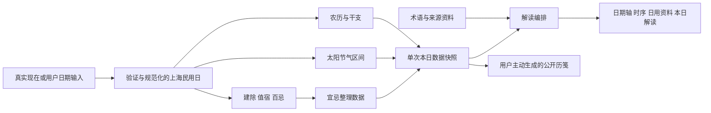

# 05｜黄历、历法计算与日期工作台建设规格

更新日期：2026-10-24（Asia/Shanghai）。

[返回开发建设总册](../DEVELOPMENT-MASTER.md) · [产品旅程](01-product-journeys.md) · [界面与无障碍](07-interface-accessibility.md) · [测试证据](10-testing-evidence.md)

## 1. 范围、状态和阅读规则

本专题覆盖当前黄历页面、底层历法口径、术语资料、目标工作台和验收方法。
当前建设继续完善静态应用，不建设在线排盘后端、账号体系、付费择日或管理后台。
所有计算仍在原生 JavaScript 模块中完成，展示改造不改变已确认算法。

### 1.1 三轴状态

| 状态轴 | 本专题采用的值 | 使用方法 |
| --- | --- | --- |
| 需求 | 已确认 / 建议 / 未来独立方案 | 工作台目标以 UI 基线为已确认；未决定的实现细节明确写建议 |
| 实现 | 已实现 / 部分实现 / 未实现 / 受门禁阻塞 | 有 CSS 或按钮不等于完整业务完成 |
| 验证 | 本轮通过 / 历史通过 / 本轮失败 / 未验证 | 只陈述对应检查的实际结果 |

本轮 `check`、`validate` 通过，validate 为 230 项、0 失败，包含历法测试脚本。
当前整站 `test:e2e` 两次失败，不能据此宣称黄历全部真实交互验收完成。
失败点分别在画布选星和快读六爻页签，原因尚待定位。
2026-10-22 截图和更早生产报告是历史证据。
移动真机、屏幕阅读器和真实浏览器 200% 缩放尚未验证。
具体日志和证据归档见 [10-testing-evidence.md](10-testing-evidence.md)。

### 1.2 功能建设任务

| 任务 | 业务内容 | 当前状态 |
| --- | --- | --- |
| `T-CAL-01` | 日期轴、历日一致性、返回今日、真实节气区间 | 已确认 / 部分实现 / 逻辑本轮通过，目标交互未验证 |
| `T-CAL-02` | 三段本日解读、来源标签、内联术语笺注 | 已确认 / 部分实现 / 目标未验证 |
| `T-CAL-03` | 公开今日历笺生成、预览、下载和可用时分享 | 已确认 / 未实现 / 未验证 |

这里规定功能和验收，不重复总册的开发任务卡。
文件所有权、任务依赖和完成签收以 [AI 执行任务](12-ai-execution-tasks.md) 为准。

## 2. 当前代码和数据地图

| 位置 | 当前职责 | 变更约束 |
| --- | --- | --- |
| `web/js/almanac-page.js` | 默认上海日期、计算编排、日期条、资料卡和术语弹窗 | 优先将日期/渲染逻辑拆清，不复制计算公式 |
| `web/js/almanac/astronomy.js` | 儒略日、太阳/月亮天文基础 | 改动要有算法夹具，不因视觉升级替换 |
| `web/js/almanac/solar-terms.js` | 定气与相邻节气信息 | 进度必须复用精确交节结果 |
| `web/js/almanac/lunar.js` | 朔月、中气和农历编排 | 保护 2033 闰十一月和民用日规则 |
| `web/js/almanac/ganzhi.js` | 年月日时干支、纳音等 | 不混淆年界、月界和日界 |
| `web/js/almanac/selection.js` | 建除、值宿、彭祖百忌、宜忌资料选择 | 属特定传统口径，不能改成科学预测 |
| `web/js/almanac/reading.js` | 术语检索与每日解读 blocks | 保留计算/资料/导读来源分层 |
| `web/js/almanac-knowledge.js` | 学习书库内的黄历术语浏览 | 与工作台复用数据，不另建一套释义 |
| `web/data/almanac-terms.json` | 术语内容 | 必须持续补来源与校验状态 |
| `web/data/almanac-yiji.json` | 宜忌整理数据 | 不能写成通用于所有学派的结论 |
| `web/js/data-loader.js` | 按需加载黄历数据 | 错误必须通过工作台可恢复呈现 |
| `test/almanac/` | 天文、农历、干支、节气、选择、集成、渲染烟测 | 运行目录由质量 runner 设置 |

页面当前采用模块级 `st` 保存日期、术语和宜忌数据。
`draw()` 重建 `mountEl.innerHTML`，随后绑定事件并调用 `window.scrollTo(0, 0)`。
这会影响焦点和滚动，改造日期轴时必须明确保留/转移规则。
不应在每个点击处理器里各自构造不同的数据快照。

## 3. 已确认历法口径

### 3.1 范围与时间基准

| 项目 | 当前约定 | 页面必须表达 |
| --- | --- | --- |
| 支持公历范围 | 1900-01-01 至 2199-12-31 | 日期控件、前后日和说明同步限制 |
| 黄历历日 | Asia/Shanghai，北京时间 UTC+8 的民用日 | 不受设备所在地时区改变 |
| 农历年界 | 正月初一 | 不写成“立春换农历年” |
| 干支年界 | 立春交节 | 与农历年份分开展示 |
| 干支月界 | 十二“节”，从立春建寅起 | 不按公历每月 1 日切月 |
| 干支日界 | 午夜 00:00 | 不默认采用晚子时 23 点换日 |
| 时辰 | 子时覆盖 23:00—01:00 等既有规则 | 时辰划分不等于另改日界 |
| 二十四节气 | 太阳视黄经每 15° 的定气结果 | 不使用固定公历日或装饰性均匀刻度 |
| 农历朔月 | 当前天文计算与民用日编排规则 | 保护同一民用日的时刻一致性 |
| 宜忌等资料 | 特定传统资料和项目整理 | 明示民俗属性、来源与流派差异 |

支持计算不等于已经得到整个 300 年范围的权威历书认证。
现有测试集中在现代年份和已知异常年，不得宣传“全范围绝对准确”。
算法参考与局限见 `docs/CONTENT-SOURCES.md`。
新增权威对照需记录来源版本、时区、日期、容差和差异。

### 3.2 Date 对象的语义

当前 `shanghaiCalendarDate(now)` 使用 `Intl.DateTimeFormat` 提取上海年月日，再构造本地字段的正午 Date。
底层许多模块从 `getFullYear/getMonth/getDate` 读取民用日字段。
`solarTermDate()` 返回以北京时间数字构造的 Date，当前代码将其当作北京墙钟时间进行比较。
这些对象不能未经判断直接序列化成 UTC instant 后交给另一套时区计算。

改造要求：

1. 变量命名区分真实时刻、所选民用日、交节墙钟时间和展示字符串。
2. 日期输入先解析年/月/日，不能依赖 `new Date('YYYY-MM-DD')` 的 UTC 解析再读取本地字段。
3. 日期键建议使用明确的 `YYYY-MM-DD` 或整数年月日比较，不能用 locale 格式当主键。
4. 输入日期要校验回读字段，拒绝 2 月 31 日等归一化成另一日的值。
5. 日期增加/减少以民用日为单位，不在跨夏令时设备上假定每当地日都等于 86400000 毫秒。
6. 抽出共享日期 helper 时保护现有对外契约，先补跨时区夹具再接入 UI。

以上是实现建议与必须满足的一致性要求，不表示当前模块已经全面重构。
不得在黄历 UI 任务中顺手修改全部学习统计日期和复习调度。
跨模块日期统一应在 `T-CAL-01` 明确调用方和迁移影响。

### 3.3 欢迎页日期差异

当前欢迎页 `main.js:getDailyHexagram()` 按设备本地年内天数选项目日卦。
欢迎日期也直接读取设备本地 Date。
黄历默认日则按 Asia/Shanghai 取得。
因此不同设备时区下，欢迎“今日”与黄历“今日”可能不同。
当前文档不能将此描述为已全站统一。
建议共享上海民用日服务并给项目日卦补跨年、闰年、跨时区测试。
是否迁移旧学习节律统计必须另外明示，避免把已有天数重新归类。

## 4. 计算与内容分层

### 4.1 数据流



每次日期变更应提交同一日的一致快照。
不能出现标题已经下一天、干支仍是上一天、术语笺注还指向旧日的混合状态。
纯计算函数不读 DOM，也不在内部获取“今天”。
页面层负责注入日期、加载状态、焦点和用户操作。

### 4.2 三类来源

| 标签 | 允许内容 | 不允许 |
| --- | --- | --- |
| 历法计算 | 公农历、干支、节气、算法推得的时序信息 | 把算法结果直接称为吉凶事实 |
| 民俗资料 | 建除、值宿、彭祖百忌、宜忌和相关传统解释 | 宣称所有学派、地区和现实场景都适用 |
| 项目导读 | 学习提示、术语解释组织、现代阅读问题 | 伪装成原典、古人原话或唯一权威 |

数据层仍可保留内容溯源的完整八层分类。
三类工作台标签是此页面的阅读分区，不应破坏原始 provenance 信息。
来源缺失时显示“待校验/待补定位”，不能只显示一个书名就标作已校验。
`reading.js` 的 fallback 文本是可用性兜底，不构成文本校勘证明。

### 4.3 术语范围

术语包含建除十二神、二十八宿、彭祖百忌、二十四节气、神煞及宜忌项目。
同名术语存在 ID 和名称检索，当前 `getTermReading()` 先按 ID 再按 name。
新增 UI 不另行在组件中写一份释义字符串表。
一条术语笺注至少应提供名称、所属资料层、解释、依据/来源状态和边界。
有地区或版本差异时显示差异提示。
未找到条目时显示缺项和去学习书库的入口，不编造释义。
正文和 tooltip 不能只有色彩，类别须有文字。

## 5. 当前页面与目标工作台逐项对照

| 功能 | 当前实现事实 | 已确认目标 | 状态与任务 |
| --- | --- | --- | --- |
| 当前日期 | 年月日和“今天”字样 | 年月日、星期、农历置于日期轴中心 | 部分 / `T-CAL-01` |
| 前后日期 | 两个含字符箭头的按钮 | 本地 Lucide 箭头，明确方向与禁用边界 | 部分 / `T-CAL-01`、`T-ICON-01` |
| 日期选择 | 常显原生 date input | 点击年月进入可访问日期选择；保留原生能力 | 部分 / `T-CAL-01` |
| 七日条 | 无 | 连续七日，当前选中日有文字/状态 | 未 / `T-CAL-01` |
| 返回今日 | 无独立动作 | 离开今日后明确显示 | 未 / `T-CAL-01` |
| 公农历干支 | 农历、三柱和纳音已有 | 暖纸日课笺，分清农历年与立春干支年 | 部分 / `T-CAL-01` |
| 节气 | 当前/下一名称和天数 | 真实区间、进度与清楚的参考时间 | 部分 / `T-CAL-01` |
| 建除值宿 | 两个可点击按钮 | 深色资料区并有明示来源 | 部分 / `T-CAL-02` |
| 宜忌 | 多个胶囊按钮 | 两列清单，图标/文字同时表达 | 部分 / `T-CAL-02` |
| 解读标题 | 所有日期都写“今日解读” | 非当天统一“本日解读” | 未 / `T-CAL-02` |
| 解读结构 | 多个条目 details，默认收起 | 三段默认展开：时序、民俗、今天可学 | 部分 / `T-CAL-02` |
| 术语 | 点击生成模态弹窗 | 工作台内术语笺注，不打断阅读 | 未 / `T-CAL-02` |
| 项目今日一卦 | 黄历工作台无专门入口 | 可选入口，明示“项目今日一卦”并回星图聚焦 | 未 / 按任务卡边界 |
| 分享 | 无黄历历笺生成器 | 仅公开日期资料的今日历笺 | 未 / `T-CAL-03` |
| 支持范围/时区 | 页脚已有 | 保持可见，不因新布局移除 | 已有 / 回归 |
| 真实手机与读屏 | 没有完整证据 | 核心日期与阅读路径可用 | 未验证 / `T-A11Y-01` |

共享主题已把黄历外观纳入沉浸星仪，不等于这一表全部已交付。
不得把尚未完成的日期轴和三段内容写进“现有功能”清单。

## 6. 目标布局

### 6.1 桌面

宽幅约 `min(1240px, 100vw - 96px)`。
星图作为外围背景，目标亮度约 15%，不在正文后制造闪烁。
第一层是日期轴和连续七日。
第二层是五列左右暖纸日课笺与七列左右深色日用资料。
第三层是默认展开的三段本日解读，以及工作台内术语笺注。
窄桌面/放大后应按内容空间转单列，不能强挤 5/7 列造成短行。
不为了满足装饰比例缩小正文到 15px 以下。

### 6.2 手机

日期主信息先于资料，前后日与返回今日可触达。
七日条可横向滚动，但页面本身不能横向溢出。
选中日应自动保持可见，横滚不能劫持整页纵向滚动。
暖纸日课、择日资料、本日解读、笺注依次纵向排列。
术语笺注可在本区展开，不另加遮罩抽屉。
软件键盘出现时，日期控件和确认/取消仍可操作。
底部交互应考虑安全区域，不能被浏览器工具条遮挡。
320px、390×844、768×1024 都要实测布局。
模拟触摸只能作为浏览器证据，不能替代 Android/iOS 真机签收。

## 7. 日期控制的详细行为

### 7.1 页面初始化

1. 进入黄历后使用上海今天，而非设备本地今天。
2. 加载术语/宜忌前显示含文字的加载状态，避免空白卡。
3. 数据齐备后一次性呈现该日的计算和资料。
4. 主标题可聚焦但不占常规 Tab；模块切换后焦点落在可理解的位置。
5. 页面范围、口径和内容边界保持可见。

当前进入模块的加载和错误主要由 `main.js` 模式加载器负责。
页面内部新增异步任务时也要提供局部状态，不能只依赖全站 spinner。

### 7.2 前一天与后一天

- 操作前检查范围，边界按钮使用原生 disabled。
- 日期变更后只改变一个民用日。
- 保留触发按钮或等价位置焦点，不把焦点丢到 body。
- 用礼貌状态消息播报完整新日期，不重复读整页。
- 只让数字/日期轴按方向轻移，其他内容短交叉淡入。
- 减少动态效果时直接稳定更新。
- 连续快速点击时最终状态对应最后一次请求，不显示过期异步结果。
- 数据或计算失败时保留上一个有效日期，并说明重试，不显示混合日数据。

### 7.3 七日轴

目标显示围绕所选日的一段连续七日。
建议采用选中日居中的三日前后三日；范围端点不足时向可用侧补足七日。
这是实现默认建议，任务实施时应在测试中固定，不能每次随机移动窗口。
每项提供星期、日号、是否今天、是否选中；需要时补农历简记。
今天和选中可以是不同日，视觉和可访问名称必须区分。
点击某日使用统一日期变更入口，不自己只更新标题。
不在七日轴加载真实内容前用假日期占位可点击。
Tab 可以逐个访问；若使用 roving tabindex，需要左右键、Home/End 和可见焦点完整实现。
不得仅添加 `role=tab` 而不实现相应键盘模式。

### 7.4 日期选择器

现有原生 date input 是可复用基础，不要求引入组件运行时。
年月触发必须是真实 button，有名称与展开状态。
如果采用原生 picker，保留可直接键盘输入的等价路径。
如果采用原生 DOM 弹层日历，必须完整实现焦点进入、日期网格、方向键、月切换、Escape 和焦点恢复。
不建议为了视觉重新开发不完整的自制日历。
确认有效日期后提交；取消不改变所选日。
空字符串、非法日期、超范围和不完整输入应显示字段错误并保留旧日。
不要把不完整输入自动变成今天，也不要自动接受 Date 的溢出归一化。

### 7.5 返回今日

所选日不是上海今天时显示“返回今日”。
触发时重新获取当前上海日期，不能永久复用进入页面时的旧今天。
跨午夜保持页面打开时，今天标记和返回目标要同步刷新或在下一次操作时重新判断。
如果用户正在看历史日，不因午夜计时器自动跳走。
回今日后保留用户理解上下文，焦点移到日期主信息或原按钮的等价位置。

## 8. 真实节气进度

当前 `currentSolarTerm()` 返回名称和整天数，没有直接暴露区间起止时间。
`daysSince` 与 `daysToNext` 分别 floor/ceil，仅适合文字提示，不足以精确重建进度。
禁止用 `daysSince / 15`、当前日号、均匀 24 格或随机动画冒充真实进度。

实施要求：

1. 从与当前算法相同的交节节点取得“区间起点”和“下一节点”。
2. 明确参考时刻属于哪个民用日及何种墙钟语义。
3. 进度为 `(reference - start) / (end - start)`，区间有效时夹在 0—1。
4. 显示起点、当前节气、下一节气及日期/时刻定位。
5. 区间为零、缺失或非法时隐藏进度并显示数据不可用，不画一个默认 50%。
6. 跨年同样能取得前一年冬至与下一年小寒，不能倒退或超过范围。
7. 用文本说明“进入第几天、距下节气多久”，视觉条不是唯一信息。

参考时刻建议对所有所选日统一使用本日北京时间 12:00，并明确标记“本日 12:00 参考”。
这样可以和当前民用日算法的正午输入保持一致，历史日不会伪装成实时钟表。
如果后续采用“今天实时、历史日正午”，必须明确区分标签并补跨交节更新测试。
两种行为不能未经声明混用。
这属于 `T-CAL-01` 的设计/实现细化，不代表现有代码已有实时节气仪。

## 9. 本日解读与术语笺注

### 9.1 三段默认展开

| 段落 | 用户要理解什么 | 内容来源 | 允许的下一步 |
| --- | --- | --- | --- |
| 时序是什么 | 公农历、干支、节气在时间结构中如何定位 | 历法计算 | 学习节气或干支 |
| 民俗怎样理解 | 建除、值宿、百忌和宜忌的传统含义及差异 | 民俗资料 | 内联查看术语 |
| 今天可以学什么 | 与当前时序有关的一项学习问题或阅读 | 项目导读 | 一个课程或经文主入口 |

非当天统一使用“本日解读”，避免把历史日期描述成真实今天。
三段首次默认展开，用户主动收起后可保持本工作台选择。
日期切换不应让正在读的笺注被无意义动画带走。
不要把现有多个 `reading.blocks` 机械改标题就当作三段内容完成。
应先编排段落层次，来源随段落展示。
项目导读不能暗示今天必然适合做某项现实决定。

### 9.2 内联术语笺注

点击资料中的术语，更新工作台内同一个笺注区域。
术语是原生 button，状态可显示当前正在解释的条目。
笺注标题可由 `aria-labelledby` 关联，内容更新用简短 live 提示。
不把整段释义不断塞进 aria-live，避免读屏被大量重复打断。
键盘用户可以选择跳到笺注，也可保留在术语按钮继续比较。
手机需要滚动到笺注时只进行一次短定位，减少动态下立即定位。
笺注关闭/清除后焦点回到触发术语，若触发元素因日期切换消失则回资料区标题。
日期切换时清除与旧日特定结果绑定的高亮，通用术语内容是否保留必须有清楚日期提示。
不得再新建模态遮罩替代这一目标。

### 9.3 空与缺项

术语未录入时显示名称、缺项说明和书库入口。
宜或忌为空时显示“暂无对应资料/无条目”，不能由空数组直接推导“诸事不宜”。
当前 `reading.js` 某些 fallback 文案会将空宜显示为“诸事不宜”；目标需核对数据语义后修正。
没有来源定位的内容显示待校验，不能为填满布局而合成貌似古籍的引文。
资料加载失败时仍可显示计算结果，但必须区分“计算有效”与“资料未加载”。

## 10. 今日历笺分享

### 10.1 内容白名单

| 可以进入图片 | 默认禁止进入图片 |
| --- | --- |
| 所选公历日、星期、农历和明确时区 | 私人占筮问题 |
| 公开干支、节气和经过整理的短说明 | 自由笔记、复讲原文 |
| 简要来源类别、内容状态和文化学习边界 | 成就内部事件、学习弱项 |
| 产品名称和公开页面链接 | 内部配置、服务地址、任何密钥 |

名称可以是“今日历笺”，但图片正文必须标出实际所选日期。
历史日期分享不能写“今天一定……”。
宜忌是否进入图中须保留民俗资料标签和边界，不能做成带确定性吉凶断言的海报。
推荐初版优先分享时序和学习提示，避免为装饰而塞入全部资料。
图片内容白名单需由数据选择函数显式组织，不能截图整个工作台。

### 10.2 交互状态

生成按钮默认可用；生成过程中 disabled 并显示文字状态。
生成前不请求用户的私人信息。
成功后打开可访问预览，提供保存图片、支持时调用系统分享、取消。
系统分享不支持时保留下载，不显示一个永远失败的按钮。
用户取消系统分享不报成生成错误，也不重复触发学习事件。
字体/绘图失败时给出重试和文本替代，不能下载空白图片。
临时 object URL 在关闭或替换预览后释放。
图片尺寸、文字换行、长术语和 320px 预览必须有回归。
分享不得改变所选日期、术语笺注和原工作台滚动。
分享预览的模态与焦点约束见 [界面专题](07-interface-accessibility.md)。

## 11. 状态与失败场景矩阵

| 场景 | 要显示什么 | 数据影响 | 焦点/恢复 |
| --- | --- | --- | --- |
| 首次加载 | 工作台骨架和“正在加载黄历资料” | 不写私人数据 | 模块标题 |
| 全部就绪 | 同一日的一致计算和资料 | 仅内存选择 | 保留入口上下文 |
| 资料下载失败 | 可用的历法部分＋失败重试 | 不制造空资料结论 | 重试按钮 |
| 日期非法 | 字段错误、支持范围和旧有效日期 | 不提交新日 | 日期输入 |
| 范围下界/上界 | 对应前后日禁用 | 不越界 | 保留当前位置 |
| 连续快速改日 | 最后选择有效，不混日 | 不保存过期快照 | 原控制位置 |
| 术语缺项 | 名称、待补和书库入口 | 不补造内容 | 术语或笺注 |
| 计算异常 | 明确无法计算、保留旧日、可重试 | 不把异常值当结果 | 日期控制 |
| 断网且缓存存在 | 可用内容、离线说明 | 不发无意义重试风暴 | 正常操作 |
| 断网且资料未缓存 | 计算与资料缺失分区提示 | 不伪造成功 | 重试/返回 |
| 存储不可用 | 日期浏览仍可工作 | 不依赖偏好写入成功 | 正常操作 |
| 分享生成中 | 进度文字、禁重复提交 | 不写学习成就 | 生成按钮 |
| 分享失败/取消 | 可恢复原因或“已取消” | 不改变日期 | 原分享按钮 |
| 午夜跨日 | 更新今天判断，不强迫跳走 | 不改用户历史日 | 保留当前阅读 |

## 12. 键盘、读屏和触控验收

### 12.1 键盘

1. 从主导航进入黄历，标题和当前日期可识别。
2. Tab 到前一天，Enter 切换且焦点不丢失。
3. 使用七日轴选择其他日期，当前日与选中日语义明确。
4. 打开日期选择器，输入日期，确认；再打开并取消，日期不变。
5. 选历史日后“返回今日”可达且有效。
6. 进入宜忌术语，Enter 更新内联笺注，无背景遮罩。
7. 从笺注返回时能找到原术语。
8. 生成历笺后焦点进入预览，Tab 不进入背景，Escape 回原按钮。
9. 在上下界按钮禁用，键盘不导致越界。
10. 焦点轮廓不被横滚裁切，也不被 sticky 标题遮住。

### 12.2 屏幕阅读器

NVDA 或 VoiceOver 应能读出所选日期、今天标志、术语状态和来源类别。
日期更新只播报一次简短结果。
民俗资料与计算结果的标题层级可分别导航。
图片分享有包含日期和性质的替代文本。
尚无本轮完整读屏证据，这些是必须采集的验收脚本。

### 12.3 手机触控

390×844 和 320px 不横向溢出。
七日横滑不误触日期，点击目标建议至少 44×44 CSS px。
前后日、返回今日、分享不需要精细点按。
输入日期时软键盘不遮挡提交或取消。
旋转屏幕后所选日、已展开段落和笺注仍清楚。
真机需记录系统、浏览器、设备、横竖屏与安全区域。
模拟视口和 CDP touch 不得填成“真机已通过”。

## 13. 历法回归夹具

以下是仓库现有测试采用的预期，不是本专题重新完成的权威历书核验。
修改算法时必须同时保存来源和差异，不把测试注释当作完整出处档案。

### 13.1 农历

| 公历日 | 现有预期 | 用途 |
| --- | --- | --- |
| 2026-07-01 | 丙午农历年，五月十七，非闰月 | 常规现代日期 |
| 2026-02-17 | 正月初一 | 春节年界 |
| 2026-02-16 | 上一农历年腊月二十九、该月 29 天 | 春节前一天 |
| 2025-01-29 | 正月初一 | 另一年春节 |
| 2024-02-10 | 正月初一 | 春节与干支参考 |
| 2023-03-22 | 闰二月初一 | 闰月识别 |
| 2023-03-28 | 仍为闰二月 | 闰月区间连续性 |
| 2025-12-21 | 农历十一月初二 | 冬至附近 |
| 2033-12-22 | 闰十一月初一 | 关键异常年，不得简化掉 |
| 2034-01-20 | 2033 农历年十二月初一 | 闰十一月之后月序 |
| 2034-02-19 | 2034 农历年正月初一 | 跨年连续性 |

同一公历日 00、12、23 时输入应得到相同农历日。
每朔月为 29 或 30 天。
非闰月月序按 11、12、1……递增，闰月不能误推进月序。
2033 测试同时覆盖 00/12/23，不能只保留正午一例。

### 13.2 节气

| 年与节气 | 现有测试参考北京时间 | 容差 |
| --- | --- | --- |
| 2026 夏至 | 06-21 16:24 | ±1 小时 |
| 2026 小暑 | 07-07 09:57 | ±1 小时 |
| 2026 大暑 | 07-23 03:13 | ±1 小时 |
| 2026 立秋 | 08-07 19:42 | ±1 小时 |
| 2025 冬至 | 12-21 23:02 | ±1 小时 |

现有注释提到参考天文台历表和简化算法容差。
若要提升精度门槛，先增补可追溯历表，不把 UI 所显示分钟数当成精度证明。
新增进度测试应覆盖交节前一刻、交节时刻、交节后一刻和跨年节点。
不要为让进度等于整天而把原有定气改成固定日期。

### 13.3 干支与时区

| 夹具 | 现有预期或约束 |
| --- | --- |
| 2000-01-01 | 戊午日，日序锚点 |
| 2026-07-01 | 丙午年、甲午月、丙子日、午时甲午 |
| 2026-07-01 23:30/00:30 | 按既有本日子时规则为戊子时 |
| 2024-02-10 子时 | 甲子时，甲己还加甲 |
| 立春前/后 | 干支年按交节切换，不跟春节一起换 |
| 十二节前/后 | 干支月按节切换，不按中气或公历月初 |
| 2026-08-28T16:30:00Z | 上海日期为 2026-08-29 |

测试未来共享日期服务时，至少加入 UTC、Asia/Shanghai 和一个有夏令时的设备环境。
默认黄历日应一致，浏览器本地墙钟不能改变支持范围和所选日。

## 14. 页面级验收清单

### 14.1 必测日期组合

- 普通日、今天、昨天、明天。
- 月末到月初、年末到年初、闰年 2 月 29 日。
- 1900-01-01、2199-12-31 和越界输入。
- 春节前后与立春前后，两个年界分别核验。
- 2023 闰二月与 2033 闰十一月。
- 节气交接附近和跨年冬至/小寒区间。
- 上海午夜前后，但设备时区设为其他地区。

### 14.2 必测界面组合

- 1440×1024：5/7 分区、三段阅读与术语区。
- 1280×720：日期控制和主要内容不被固定条遮挡。
- 768×1024：内容转列，日历/笺注可达。
- 390×844：触摸、日期输入和预览。
- 320px：文字不挤成单字孤行，页面无横向溢出。
- 真实浏览器 200%：导航、日期、术语和分享完整可达。
- 减少动态：日期改变稳定、无持续进度光流。
- 强制颜色：选中、焦点、禁用、宜忌都有非色彩语义。

### 14.3 必测失败组合

- 数据请求失败、缺少术语、空宜忌、缺来源定位。
- 非法日期、程序注入越界和不安全年月日。
- 快速切换产生过期回调。
- 分享不支持、生成失败、用户取消、下载可用。
- localStorage getter/setter 抛错时仍可浏览日期。
- 从其他工作台进入/离开后无遗留遮罩或焦点陷阱。

## 15. 测试命令和证据要求

优先通过仓库 runner，避免手工 cwd 与历法测试约定不一致。

```powershell
npm run check
npm test
npm run validate
npm run test:e2e
```

定向逻辑测试可运行 `node web/test/almanac-timezone.test.mjs`。
历法脚本入口为 `test/almanac/*.test.mjs`，质量 runner 会使用所需工作目录。
新增日期轴、进度、内联笺注与分享需增加关键边界测试，不只检查模板中有没有字符串。
真实输入验收使用鼠标、触摸和键盘，不能仅用 evaluate 中的 `.click()` 调用。
所有通过记录要附代码快照、环境、命令和日期。
改动后默认 e2e 失败必须保留，不因开启截图后偶尔通过就删除失败证据。

本专题未追加运行新的大测试。
现有 `validate` 本轮通过只能说明已配置的检查和夹具通过，不能证明尚未实现目标。
详细记录见 [测试证据](10-testing-evidence.md)。

## 16. 禁止和非目标

- 不改既有历法、六位卦码和占筮关系来迎合 UI。
- 不把黄历所有内容标为“科学计算”。
- 不把空数据解释成凶日或诸事不宜。
- 不引入第三方在线黄历接口作为无说明的替代。
- 不把私人问题和笔记带入历笺。
- 不把浏览器 date input 的存在当成完整键盘验收。
- 不把 Lighthouse 分数当成历法准确性或读屏合格证明。
- 不以本任务为理由解锁六家注疏或部署新的服务端。

## 17. 事实依据与继续开发入口

当前事实来自 `almanac-page.js`、历法目录、`almanac/reading.js` 和现有历法测试。
目标来自 `docs/UI-DESIGN-BASELINE.md` 第 8、10、11、12 节。
内容边界来自 `docs/CONTENT-SOURCES.md`。
相关 UI、声音、图标和模态要求见 [07-interface-accessibility.md](07-interface-accessibility.md)。
开发顺序优先日期与历日一致性，再三段和术语，再历笺分享。
每阶段保留算法夹具，记录当前实现和未验证项，不将设计目标写成现状。
