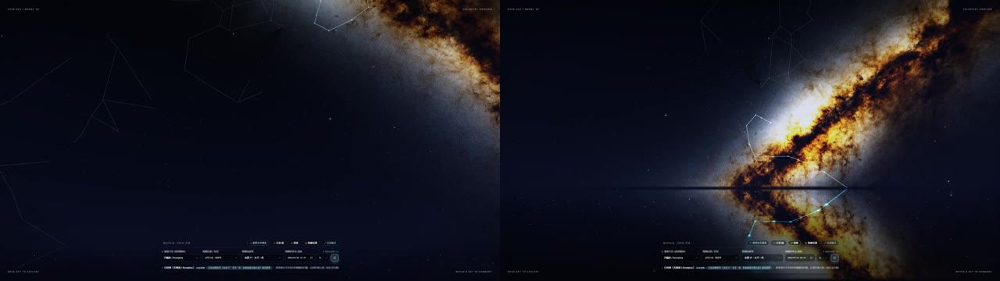
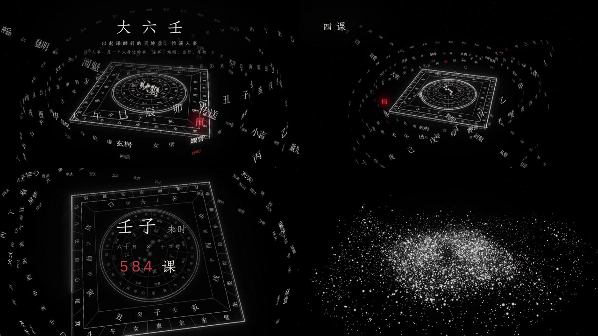

# 星空参考二次拆解 · 2026-10-22

本轮对应用户要求“继续参考链接内容，学习设计元素”。交付为原帖画面的观察、与易象图谱现状的对照，以及后续设计调整顺序。本文中的建议尚未进入运行代码；既有生命周期修复和测试记录仍见交接文档第 19 节。

## 1. 证据与阅读边界

通过 `agent-reach` 路由到 OpenCLI，读取两条用户提供的完整笔记链接，并取得视频用于本地抽帧。抽帧时间以各视频起点为零点，不是网页发布时间。

| 参考 | 原帖与作者 | 文件规格 | 本轮检查时点 |
| --- | --- | --- | --- |
| A · 自然银河 | [把星表和银河写进了一个网页vibecoding](https://www.xiaohongshu.com/explore/6abaa596000000001a0319d1?xsec_source=app_share&xsec_token=CBakzIa-Ih-w4HynG2dgnPPOx21j55NyzlSXzuyRW3570=) · 子鱼尘AI | 1280×720，30 fps，39.81 秒 | 00:02、00:14、00:24、00:34，另查看低频抽帧总览 |
| B · 天秩星盘 | [天秩：大六壬](https://www.xiaohongshu.com/explore/6ab79a4f0000000014032b36?xsec_source=app_share&xsec_token=CBgzomJwF-__K0bDyV9hFJQ_68_Z6e6luqS2C-Xv6MoG0=) · 造序001 | 1280×720，30 fps，60.05 秒 | 00:02、00:08、00:16、00:24、00:32、00:40、00:48、00:56，另查看低频抽帧总览 |

视频与完整抽帧留在本机临时目录；下方两张低分辨率拼图是用于设计评论的少量画面摘录，保留原作者与来源。它们仅放在 `docs/screenshots/`，不作为网站背景、纹理或其他运行资源。

本文区分三类信息：画面可直接核实的观察、作者正文的说明、针对本项目的设计建议。没有测量原作的 shader 参数、镜头速度或缓动曲线；不能把下述建议写成原作的技术事实。

## 2. 参考 A：银河的亮暗结构与场景纵深

上图从左到右为 00:02、00:24。

| 元素 | 直接观察 | 设计作用 | 本项目可借鉴的方式 |
| --- | --- | --- | --- |
| 主光带与留白 | 00:02 银河主要进入右上角，其余天空保留大面积深蓝黑；00:24 银河斜穿右半画面 | 有清楚的视觉重心，暗区让亮带显得更有体积 | 银河保留一条能辨认的主走向，给卦星和文字留下安静区域 |
| 暗尘缝 | 亮带内部有不规则、分叉、深浅变化的暗部 | 暗尘切开亮带，形成厚度和纹理，避免成为柔光渐变条 | 用多尺度暗尘和局部亮尘塑造结构，不能只提高整幅背景曝光 |
| 冷暖边界 | 外缘偏冷灰白，部分亮带内部明显偏暖赭金 | 冷暖变化集中在同一结构内，保持统一色调 | 背景以冷银灰为主，仅在银河局部保留暖意，与项目金色信息层拉开角色 |
| 星点尺度 | 大量极细弱点，少数有明显亮核的星；星点不会全部成为大光斑 | 亮点差异让远近和主次自然出现 | 远星以细点为主，明显光晕优先分配给当前卦与当前关系 |
| 星座连线 | 普通连线很细、偏暗；局部选中结构出现青白高亮 | 关系可以被看见，又不覆盖天幕 | 只突出当前阅读关系；轮廓和流光都依附同一条关系，避免同时显示所有网络 |
| 地平线与倒影 | 00:14、00:24 可见水平边界与下方反射；天空、倒影形成连续方向 | 提供上下和远近的参照，场景显得可进入 | 学习“稳定参照＋空间连续性”：由星群中心、外围轨道和镜头反馈承担；海面不自动成为项目需求 |
| 工具区 | 控件集中在画面底部一小块，其他说明贴边 | 天空是画面主体，工具处于辅助位置 | 采用紧凑的常驻操作和按需展开说明，但保留现有字号、触控和键盘可达性底线 |

作者正文另说明了拖动环顾、海面模式和星座观测功能。这些是作者对原作的介绍，不等同于本轮已操作原网页验证，也不意味着易象图谱要增加天文坐标系统。

需要修正此前过于简化的描述：这条参考不是“所有元素都压到很暗”。银河的局部亮带很强，沉静感来自亮区集中、暗区充足、工具区克制。

## 3. 参考 B：文字、线框与空间层级

上排从左到右为 00:08、00:24，下排从左到右为 00:40、00:56。

| 元素 | 直接观察 | 设计作用 | 本项目可借鉴的方式 |
| --- | --- | --- | --- |
| 几何骨架 | 线框方盘与同心圆共同构成中心，斜向透视清楚 | 复杂内容有稳定的几何锚点 | 保持卦族、卦、爻的现有语义结构；线条应解释真实图式，避免增加无含义的中心盘 |
| 文字进入空间 | 多层环带有不同字号、位置、角度和明暗，前后层相互穿插 | 文字成为结构的一部分，深度来自整体空间关系 | 场景标签可按层级和深度变化；完整经文仍在清晰稳定的阅读面板中 |
| 单点强调 | 大部分为黑、白、灰，少数“日”等字或数值使用局部红色 | 视线能快速找到当前强调对象 | 学习“小面积强调”的分配规则；项目继续使用既有状态色，不直接把普通选中统一改成红色 |
| 明暗梯度 | 中心轮廓更清楚，远处字环更暗，背景有细弱星点 | 密集内容仍有主次 | 当前卦、当前关系、背景地标分级；提高主对象对比时同步降低次要信息竞争 |
| 展示顺序 | 00:08 介绍整体；00:16、00:24、00:32 分别出现不同结构说明；00:40 转向大字数值；00:48 有典籍界面；00:56 是密集粒子星系 | 通过更换叙述重点，使观众逐步理解层级 | 对应“银河 → 卦族 → 卦 → 爻”的阅读顺序；一次只展开当前层级需要的信息 |
| 粒子段落 | 片头总览与 00:56 均有大量白色粒子形成盘状结构 | 粒子承担开场或收束的视觉事件 | 可作为低频的入场或教学演示候选，不据此增加持续运行的满屏粒子 |

第二条同样不能只概括成“稀疏星点＋细线”：星盘段落实际有密集文字环，片尾还有高密度粒子。它们在展示中的吸引力，来自近远层级和焦点切换；不能据此让日常阅读页面同时常驻全部效果。

抽帧可以核实镜头构图与层级的变化，不能精确还原连续运动的速度和缓动。后续若实现镜头或粒子过渡，应单独录制、慢放和检查可中断性。

## 4. 与当前易象图谱的差距

本轮实际查看本地浏览器 `?hex=001011` 的渐卦详情，缩放读数为 259%。银河斜带和暗尘已可见，不能把现状描述为“尚未实现银河”。当前更明显的问题是焦点附近多条金色关键词相互重叠；详情面板、金色卦象、场景文字也同时占据较高视觉权重。

| 优先级 | 当前差距与代码入口 | 下一步调整 | 验收方式 |
| --- | --- | --- | --- |
| P1 | `star-map.js` 的关键词直接 `fillText`，未进入卦名标签的避让流程，见约 1295–1337 行 | 关键词和卦名共享占位边界；当前卦名优先，关键词按重要度限量，避开星核与焦点光圈 | 对渐、乾、坤在 100%、200%、高倍率聚焦下截图；不得字压字、字压星核；没有空间的次要词延后展开 |
| P1 | `main.css` 的 `.relation-layers` 常驻较大卡片，桌面宽度上限 356px，见约 2501、3616 行；打开详情时该卡片隐藏 | 全景默认保留图式和当前关系的简洁入口，说明、图例和文字关系列表按需展开 | 390、768、1440 宽度下都能看到主要星群和完整操作入口；展开后可键盘操作并保留等价文字入口 |
| P2 | `star-map.js` 普通卦、纯卦、关系卦与焦点均有叠加光晕和六爻卫星，见约 1247–1270 行 | 拉开硬核、外晕与焦点的等级；优先减少普通卦的光晕竞争，不统一压暗全部背景 | 黑白预览仍能首先辨认当前卦与关系目标；六爻可区分；文字对比不下降 |
| P2 | 背景远星主要均匀随机，银河另补密集尘点，见 `star-map.js` 约 351–430 行 | 在预渲染阶段引入低频疏密变化，形成少数近乎无星的暗区；保留确定性随机 | 同一尺寸重复生成一致，调整窗口不换一片天空；静态比较能辨认疏密，运行时不逐帧生成纹理 |
| P3 | 已有四级观察层次和镜头同步，界面与场景仍可进一步协调 | 用“全景少字、聚焦单卦、近景读爻”控制展开顺序；外轨、文字与镜头围绕同一对象 | 录制选卦、切换关系、返回全景；每一步主对象连续，快速切换可中断，减少动态效果路径仍可理解 |

上述为设计实施建议，不是本轮已修复项。先解决关键词可读性和界面遮挡，再调整光晕、疏密或新增运动；不要同时修改所有视觉参数。

## 5. 后续实现约束

- 一个主视觉系统：自然银河提供背景纵深，银白线条提供结构，项目金色承载阅读与当前焦点；新增颜色先说明状态含义。
- 亮度服务于层级：远星、银河云带、结构线、当前卦和文字具有不同角色；局部银河可以明显，当前卦仍需清楚。
- 文字进入画布必须有数量与碰撞约束。借鉴空间文字的层次感，不能把经文当成绕场装饰。
- 精简浮层通过渐进展开实现，不通过缩小正文、缩小触控目标或移除辅助技术入口换取留白。
- 新增运动只在入场、选卦、关系切换或教学演示等明确事件触发；尊重 `prefers-reduced-motion`，保持离屏和弹层暂停规则。
- 背景仍使用项目生成资产。参考截图仅为文档证据，海面、倒影、大六壬内容和原作代码都不自动进入应用范围。
- 正式实施时先读取 `docs/UI-DESIGN-BASELINE.md`，为行为变化补充有意义的回归覆盖，运行 `npm run validate` 与相关浏览器检查，并保存前后截图。

## 6. 本轮验证与接手入口

- 已读取两条原帖正文，实际取得两段视频并检查上述时点；视频规格来自本地媒体探测。
- 已通过浏览器截图观察当前渐卦详情，代码侧只读检查了关键词、星点、银河、外轨和关系浮层。
- 本轮新增本文和两张参考拼图，并补充既有星空计划与交接文档链接；没有改动应用 JavaScript、CSS 或数据。
- 本轮不重用旧测试结果作为新结果。运行代码的最近一轮验证见[交接文档第 19 节](../handoff/2026-10-06-project-handoff.md#19-2026-10-22-天象舞台生命周期收尾)。
- 接手阅读顺序：[UI 基线](../UI-DESIGN-BASELINE.md) → [首轮星空实现](../plans/2026-09-30-starfield-reference-design.md) → 本文 → [当前交接状态](../handoff/2026-10-06-project-handoff.md)。
